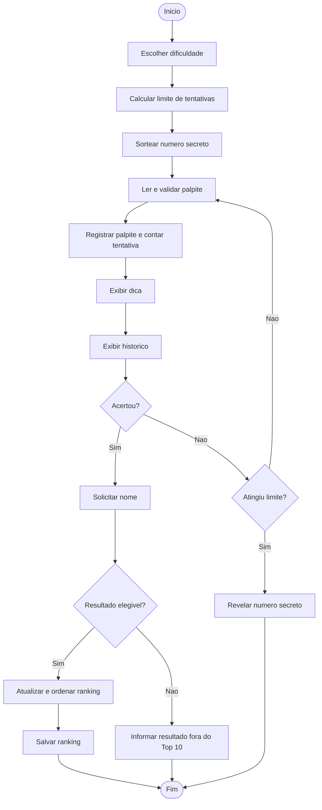
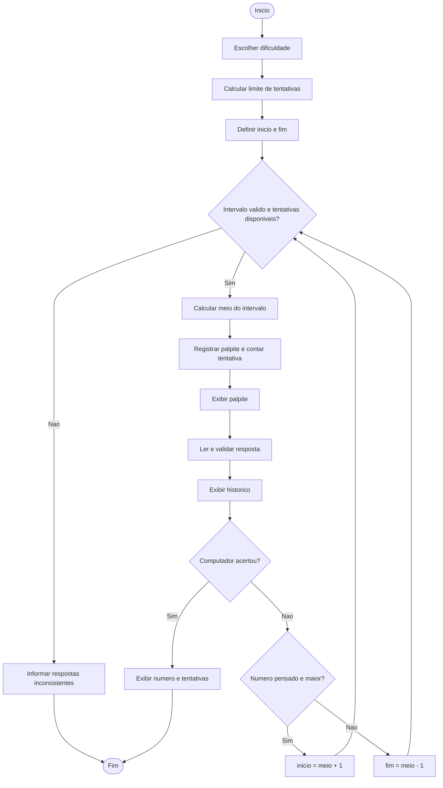

Projeto X1 - Adivinhe o Número do Vilão Cipher
1. Descrição do projeto
O projeto consiste no desenvolvimento de um jogo de adivinhação
em linguagem C, inspirado em um terminal de segurança futurista.
O jogador foi capturado pelo vilão Cipher e precisa descobrir
um código secreto para conseguir escapar.
O sistema possui dois modos de jogo, níveis de dificuldade,
histórico de palpites, ranking e armazenamento dos resultados
em arquivo.
2. Objetivos
Aplicar os conhecimentos adquiridos na disciplina de Sistemas
com C/C++, utilizando estruturas de dados, algoritmos de busca,
ordenação, funções e manipulação de arquivos.
3. Tecnologias utilizadas
- Linguagem C99.
- Compilador GCC.
- Visual Studio Code.
- GitHub Codespaces.
- Git e GitHub.
- Cores ANSI para personalização do terminal.
- Python 3 exclusivamente para automação dos testes.
4. Bibliotecas utilizadas
Biblioteca	Finalidade
stdio.h	Entrada, saída e manipulação de arquivos
stdlib.h	Números aleatórios, conversão e valor absoluto
string.h	Manipulação de strings
time.h	Inicialização do gerador aleatório
ctype.h	Validação de caracteres
math.h	Cálculo do limite de tentativas

5. Funcionalidades
- Menu principal utilizando switch.
- Modo humano de adivinhação.
- Modo IA utilizando busca binária.
- Três níveis de dificuldade.
- Limite de tentativas calculado com log2.
- Validação das entradas.
- Histórico de palpites.
- Indicadores de temperatura com cores ANSI.
- Ranking dos dez melhores resultados.
- Ordenação utilizando Insertion Sort.
- Persistência do ranking em arquivo.
6. Níveis de dificuldade
Nível	Intervalo	Tentativas
Fácil	1 a 100	7
Médio	1 a 1000	10
Difícil	1 a 10000	14
O limite de tentativas é calculado utilizando:		

tentativas = ceil(log2(limite))
7. Estruturas de dados
7.1 Estrutura Jogador
typedef struct Jogador {
    char nome[50];
    int tentativas;
} Jogador;
A estrutura Jogador é utilizada para armazenar o nome e a
quantidade de tentativas de cada participante.
O ranking utiliza um vetor com capacidade para dez jogadores.
Esse vetor é declarado na função main e passado por parâmetro
para as demais funções.
7.2 Estrutura Palpite
typedef struct {
    int numero;
    int distancia;
} Palpite;
Essa estrutura armazena cada número informado pelo jogador
e sua distância em relação ao número secreto.
Foi utilizado um vetor com capacidade para 14 palpites,
correspondente ao limite máximo do nível difícil.
8. Funcionamento do jogo
8.1 Modo humano
O computador sorteia um número secreto dentro do intervalo
da dificuldade selecionada.
O jogador informa seus palpites e recebe dicas indicando
se o número secreto é maior ou menor.
Ao acertar, o jogador informa seu nome e o resultado pode
ser registrado no ranking.
Caso o limite de tentativas seja atingido sem acerto,
o sistema revela o número secreto.
8.2 Modo IA
O jogador pensa em um número e o computador tenta descobri-lo
utilizando busca binária.
A cada tentativa, o computador calcula o meio do intervalo.
O usuário responde:
- : O número pensado é maior.
- < : O número pensado é menor.
- = : O computador acertou.
  O intervalo é reduzido aproximadamente pela metade a cada
  tentativa.
  Caso as respostas sejam contraditórias, o sistema informa
  que não foi possível descobrir o número.

9. Fluxograma do modo humano

10. Fluxograma do modo IA

11. Análise de Complexidade
Para a análise, consideramos:
- n: quantidade de números possíveis no intervalo.
- r: quantidade de jogadores no ranking.
- t: quantidade de tentativas realizadas.
11.1 Modo humano
Cada palpite é comparado com o número secreto em tempo O(1).
Como o limite de tentativas é calculado utilizando log2,
a quantidade máxima de palpites é O(log n).
Entretanto, o programa exibe todo o histórico a cada tentativa.
O trabalho total para exibir o histórico é:
1 + 2 + 3 + ... + t
Portanto:
T(t) = t(t + 1) / 2
Como t é limitado por O(log n), a complexidade total do modo
humano, incluindo a exibição repetida do histórico, é
O((log n)^2).
Em uma versão generalizada, com capacidade proporcional ao limite de tentativas, o histórico ocuparia O(log n). Nesta implementação, o vetor tem capacidade fixa de 14 elementos, portanto ocupa O(1). A análise considera entradas válidas ou um número limitado de repetições por entrada inválida e separa o custo do ranking.
11.2 Modo IA
O computador utiliza busca binária para descobrir o número.
A cada tentativa, aproximadamente metade das possibilidades
é eliminada.
Para um intervalo de 1000 números:
log2(1000) = aproximadamente 9,97
Arredondando para cima, temos 10 tentativas.
A complexidade da busca binária é O(log n).
O programa também exibe todo o histórico a cada tentativa.
Por isso, considerando a impressão repetida do histórico,
o custo total do modo IA é O((log n)^2).
A busca não utiliza força bruta.
11.3 Ordenação do ranking
O ranking utiliza o algoritmo Insertion Sort.
No melhor caso, quando o vetor já está ordenado, sua
complexidade é O(r).
No caso médio e no pior caso, sua complexidade é O(r^2).
Como o ranking possui no máximo dez jogadores, o custo
é constante em relação ao tamanho do intervalo do jogo.
11.4 Persistência dos dados
A função salvarRanking percorre o vetor e grava cada jogador no arquivo ranking.txt, com custo O(r).

A função carregarRanking utiliza fscanf, valida os registros e ordena os jogadores com Insertion Sort. Considerando B como a quantidade de bytes examinados no arquivo, o custo de carregamento é O(B + r²) no pior caso. Para registros válidos de tamanho limitado, B é O(r), resultando em O(r²).
11.5 Resumo das complexidades
Operação	Complexidade
Sortear número	O(1)
Verificar palpite	O(1)
Quantidade de palpites humanos	O(log n)
Busca binária da IA	O(log n)
Exibir histórico uma vez	O(t)
Exibir histórico durante todo o jogo	O((log n)^2)
Ordenar ranking	O(r^2)
Exibir ranking	O(r)
Salvar ranking	O(r)
Carregar e ordenar ranking	O(B + r²)

11.6 Gerenciamento de memória
O programa utiliza vetores de capacidade fixa e não realiza
alocação dinâmica.
Por isso, não é necessário utilizar malloc ou free.
Os arquivos abertos são fechados utilizando fclose.
Considerando as capacidades fixas de 10 jogadores e 14
palpites, o espaço efetivamente reservado é constante.
12. Ranking
O ranking armazena até dez resultados.
Os jogadores são organizados em ordem crescente de tentativas,
ou seja, quem acertar utilizando menos tentativas ficará
melhor posicionado.
Em caso de empate, a ordem anterior é preservada.
Quando o ranking está cheio, um novo resultado somente
substitui o último colocado se possuir menos tentativas.
O ranking é único para os três níveis de dificuldade, seguindo a estrutura Jogador solicitada no enunciado. Isso pode favorecer partidas mais fáceis. Na leitura do arquivo, são considerados os primeiros dez registros válidos; o arquivo gerado pelo próprio jogo respeita esse limite.
Os resultados são armazenados no arquivo ranking.txt.
13. Compilação
Abra o terminal na pasta do projeto e execute:
gcc -std=c99 -Wall -Wextra -pedantic main.c -o cipher -lm
O parâmetro -lm é utilizado para vincular a biblioteca
matemática.
14. Execução
Linux ou GitHub Codespaces
./cipher
Windows
Com GCC instalado, compile com gcc -std=c99 -Wall -Wextra -pedantic main.c -o cipher.exe -lm. A execução depende das políticas de segurança locais. O ambiente validado foi o Codespaces.
.\cipher.exe
15. Testes e validação do sistema
O projeto foi validado por testes manuais e automatizados no GitHub Codespaces. Os scripts em Python 3 não alteram a implementação principal em C.
15.1 Testes automatizados iniciais
Nº	Teste	Resultado
01	Compilação sem erros e avisos	Aprovado
02	Menu principal	Aprovado
03	Validação de entradas numéricas	Aprovado
04	IA — nível fácil	Aprovado
05	IA — nível médio	Aprovado
06	IA — nível difícil	Aprovado
07	Busca binária no pior caso	Aprovado
08	Respostas contraditórias	Aprovado
09	Validação dos símbolos da IA	Aprovado
10	Ranking vazio	Aprovado
11	Ordenação do ranking	Aprovado
12	Limite de 10 registros carregados	Aprovado
13	Persistência do ranking	Aprovado
14	Encerramento do programa	Aprovado

15.2 Testes automatizados complementares
Nº	Teste	Resultado
15	Modo humano — fácil	Aprovado
16	Modo humano — médio	Aprovado
17	Modo humano — difícil	Aprovado
18	Validação de palpites inválidos	Aprovado
19	Substituição do último colocado	Aprovado
20	Rejeição de resultado fora do Top 10	Aprovado
21	Tratamento de registros inválidos	Aprovado
22	Presença dos códigos ANSI	Aprovado

15.3 Resultado consolidado
Indicador	Resultado
Total de testes automatizados	22
Aprovados	22
Reprovados	0
Taxa de aprovação	100%
Erros de compilação	0
Avisos de compilação	0

Também foram realizados testes manuais dos modos de jogo, vitória, derrota, histórico e persistência. Os resultados referem-se aos cenários executados; a presença de códigos ANSI não comprova a aparência visual das cores.
15.4 Como executar os testes
No Linux ou GitHub Codespaces, com GCC, Python 3 e utilitários timeout e stdbuf disponíveis:
gcc -std=c99 -Wall -Wextra -pedantic main.c -o cipher -lm
python3 testes.py
timeout 60s python3 testes_complementares.py
Os scripts utilizam diretórios temporários para preservar o ranking original. O script complementar utiliza o executável cipher compilado previamente.
16. Considerações finais
O desenvolvimento deste projeto permitiu aplicar os conhecimentos adquiridos na disciplina de Sistemas com C/C++, utilizando estruturas de dados, funções, busca binária, algoritmos de ordenação e manipulação de arquivos.

A busca binária tornou o modo IA eficiente, reduzindo a quantidade de tentativas necessárias para descobrir o número secreto. A modularização facilita a organização, manutenção e compreensão do código.

Foram executados 22 testes automatizados, com 100% de aprovação nos cenários avaliados, além da compilação sem erros ou avisos. O projeto também possibilitou a aplicação de práticas de versionamento, documentação técnica e automação de testes.
17. Informações acadêmicas
Instituição: Faculdade Senac Ceará
Curso: Análise e Desenvolvimento de Sistemas
Disciplina: Sistemas com C/C++
Projeto: X1 - Adivinhe o Número do Vilão Cipher
Desenvolvedora: Janaina Aparecida Chiorato
Semestre: 2026.2